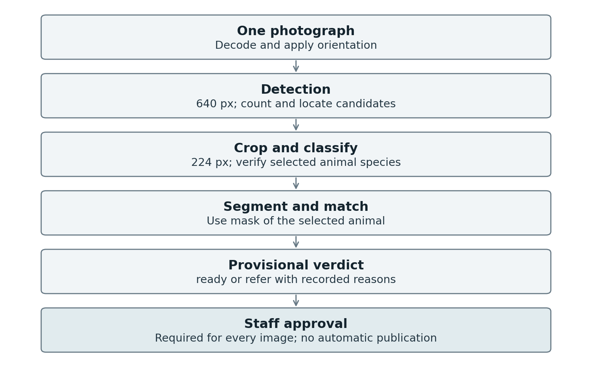

# Smart Pet Vision

[](https://github.com/Yasser-20-alhajlah/smart-pet-vision/actions/workflows/phase2-tests.yml)

Capstone project for AI251P Applied Computer Vision (KAUST). The system reviews a pet photo for a shelter adoption listing: it finds the animal, confirms the species, segments the body and decides whether the photo is ready or needs review by a staff member. Every verdict goes to a staff member for approval.



## Results (Oxford-IIIT Pet test split, used once)

| Component | Model | Test result |
|---|---|---|
| Detection (M4) | YOLO11s, 640 px, conf 0.40, NMS 0.50 | mAP50 0.984, mAP50–95 0.850, P/R/F1 0.958 / 0.959 / 0.959 |
| Segmentation (M5) | YOLO11s-seg, 640 px, conf 0.25 | mean IoU 0.923, Dice 0.959, mask mAP50–95 0.875 |
| Segmentation baseline | SAM 2.1-B with the true box (300 test images) | mean IoU 0.812 |
| Service (M8) | PyTorch, T4, in-process | p95 61.4 ms |
| Service (M8) | PyTorch, CPU, over HTTP | p50 / p95 / p99 383.8 / 430.8 / 690.1 ms |

Data: [Oxford-IIIT Pet](https://www.robots.ox.ac.uk/~vgg/data/pets/) (Parkhi et al., CVPR 2012, CC BY-SA 4.0), 7,335 images after cleaning, group-aware split 5,123 / 1,106 / 1,106 (seed 42).

Acceptance criteria A1–A8 and A9a are met. **A9b is not met**: the ONNX detector differs from PyTorch by 0.0018–0.0020 against a bound of 0.001, so the service runs the PyTorch detector. Details are in the Phase 2 report, section 4.

Experiment tracking: [W&B project](https://wandb.ai/yasser-alhajlah-kaust/smart-pet-vision) (detector run `2seovilv`, segmenter `3ztpz2tc`, SAM baseline `1jb5y453`, T4 service `fqow5ly7`, CPU HTTP `mu2tolkg`).

## Repository layout

| Path | Content |
|---|---|
| [`smart-pet-vision/`](smart-pet-vision/README.md) | Phase 1: data (M1), classification (M2–M3), report `SmartPetVision_Phase1.pdf` |
| [`smart-pet-vision/phase2/`](smart-pet-vision/phase2/README.md) | Phase 2 code (`src/spv`), notebooks, tests, tools |
| `smart-pet-vision/phase2/submission/` | Phase 2 report source on the course template (`main.tex`, `figures/`, `build.sh`) |
| `smart-pet-vision/phase2/report/evidence/` | Saved evaluation files; the source of every number in the report |
| `smart-pet-vision/phase2/docs/model_card.md` | Model card: intended use, limits, failure modes |

## Quick start

```bash
cd smart-pet-vision/phase2
pip install -r ../requirements.txt
PYTHONPATH=src python -m unittest discover -s tests   # unit tests
python tools/verify_submission_evidence.py            # report numbers vs. saved evidence
```

Running the service needs the trained weights and `runs/manifest.json`, which are not in Git (over 100 MB):

```bash
SPV_MANIFEST=runs/manifest.json PYTHONPATH=src uvicorn spv.serve:app --port 8000
```

Real-weight runs use Google Colab (T4) with `notebooks/06_release_validation_v2.ipynb`. Building the report PDF needs LaTeX: `cd submission && ./build.sh`.

## Privacy

The 401 team photos (503 animals) are an evaluation-only set and are not published here or on W&B. Student IDs are not stored in the current files.

## Team

| Member | Work stream |
|---|---|
| Abdulrahman Mastour Alharthi | WS1 data and classification |
| Yasser Mansour Alhajlah | WS2 detection |
| Mohammed Adeeb Alrashdi | WS3 segmentation |
| Musaad Obaied Saad Alqahtani | WS4 integration and deployment |
