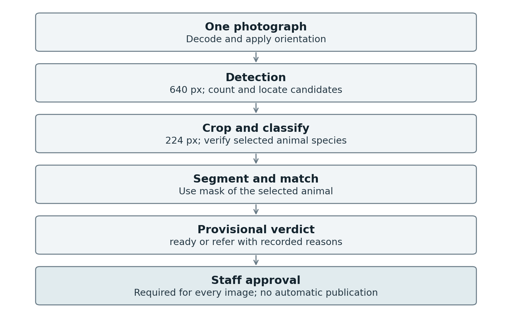

# Smart Pet Vision Phase 2 Report

Phase 2 report: detection (M4), segmentation (M5), integration and deployment (M8)

AI251P Applied Computer Vision | KAUST Academy | Phase 2 due 15 November 2026. Historical training: 18-19 October on Tesla T4; team-recorded reproduction: 23 October; supplemental analysis: 24 October; prior CPU regression: 30 October 2026. No new training is claimed in this document edit.

Team: Abdulrahman Mastour Alharthi (WS1 data and classification); Yasser Mansour Alhajlah (WS2 detection); Mohammed Adeeb Alrashdi (WS3 segmentation); Musaad Obaied Saad Alqahtani (WS4 integration).

Sections 1-6 preserve historical model results; Sections 8-9 preserve the earlier CPU record. Section 12 records the earlier software-only review. Section 13 contains the latest trained-weight 401-photo regression, 300 real HTTP requests, fresh-process CPU benchmarks and 49 passing tests. The detector raw-head parity criterion and 17 multi-animal referrals remain unresolved.

Dataset metadata rechecked directly from the saved Phase 1 CSV: 7,335 cleaned Oxford images (2,366 cats and 4,969 dogs); train/validation/test image counts 5,123/1,106/1,106, with breed-stratified near-duplicate groups and seed 42. Reuse exactly these roles for M4/M5. Different poses of the same animal and possible pretraining overlap remain unresolved identity limitations. The 401-photo benchmark contains 178 cat, 221 dog and 2 mixed-species images with 503 annotated animals; it is external to training but already inspected.

## 1 Detection M4

Function in the system: locate animal candidates and supply a crop to the classifier. Detected counts support no-animal and multiple-animal referrals. A missed additional animal can bypass the count-based rule; the final output therefore requires staff approval even when its technical verdict is ready.

### 1.1 Ground truth and training

Body boxes are derived from the Oxford trimaps (tight box around foreground plus border) and were reviewed on a random sample of 300 images (1.3% loose boxes, none missing the animal). The conversion to YOLO format was verified for all 7,335 labels by decoding every label file back to pixels: 0 missing, 0 class mismatches, largest coordinate difference 0.0009 px (rounding to six decimals); M4_yolo_label_check.jpg shows 24 decoded training labels drawn on their images. YOLO11s is fine-tuned for 40 epochs at 640 px on the train split (W&B run https://wandb.ai/yasser-alhajlah-kaust/smart-pet-vision/runs/2seovilv).

### 1.2 Operating point

Confidence (0.05-0.70) and NMS IoU (0.50-0.70) were swept on validation. The recorded rule selects the highest F1 among settings with recall at least 0.80: confidence 0.40 and NMS IoU 0.50, with validation precision 0.959, recall 0.957 and F1 0.958. A missed sole animal can trigger referral, while a missed additional animal can incorrectly yield ready. AP is the area under a confidence-ranked precision-recall curve; mAP50 uses matching IoU 0.50 and mAP50-95 averages the IoU levels 0.50 through 0.95. These are distinct from P/R/F1 at the fixed operating point [R3].

| Metric (test, n = 1,106 images, 640 px) | Value |
| --- | --- |
| mAP50 / mAP50-95 | 0.984 / 0.850 |
| AP50 / AP50-95 per class | cat 0.994 / 0.888; dog 0.973 / 0.812 |
| Precision / recall / F1 at the operating point (conf 0.40, NMS 0.50) | 0.958 / 0.959 / 0.959 (TP 1,061, FP 46, FN 45) |
| Per class at the operating point (P / R / F1) | cat 0.980 / 0.983 / 0.982; dog 0.948 / 0.948 / 0.948 |
| Recall by size (COCO pixel buckets) | large 0.959 (n = 1,105); medium 1.0 (n = 1); no small objects in the split |

### 1.3 Error breakdown and failure case

Historical Oxford test evaluation: 1,106 images; detector input 640 px; confidence 0.40 and NMS IoU 0.50. The following FP and FN taxonomies describe separate detection-error counts from M4_fp_breakdown.csv and M4_fn_breakdown.csv. Categories use overlap around the 0.50 IoU matching boundary as recorded below; a single image can contribute to both columns.

| False positives (46) | n | False negatives (45) | n |
| --- | --- | --- | --- |
| Localisation (same class, IoU 0.1-0.5) | 34 | Localisation (a box overlaps, IoU 0.1-0.5) | 34 |
| Class confusion (IoU >= 0.5, other class) | 10 | Class confusion | 4 |
| Localisation and class | 1 | Missed (no box at all) | 7 |
| Background (IoU < 0.1) | 1 |  |  |

- Localisation-related cases dominate the recorded breakdown. Thirty-eight images contain both an FP and an FN. A displaced prediction may contribute one unmatched prediction and one unmatched ground truth under the matching rule; this is not double-counting an image-level error rate. Loose trimap-derived boxes are a possible contributor in the displayed examples, not a demonstrated explanation for all 38 cases.

- Class confusion (11 boxes): 5 dogs labelled cat, mostly small, curled-up or dressed dogs (chihuahua_156, cat 0.86; wheaten_terrier_153, cat 0.73; beagle, pug, samoyed), and 6 cats labelled dog, mostly long-haired or hairless breeds (Birman_194, Sphynx_190, Persian_89, Ragdoll, Maine Coon, Egyptian Mau).

- Failure case: chihuahua_156, a black Chihuahua wearing a sweater. Clothing and low contrast are plausible visual explanations for the cat prediction, not experimentally isolated causes. The historical pipeline reports dog from the classifier and refers this image for disagreement (M8_class_confusion_pipeline.csv). Across the 11 detector-confusion cases, 9 were referred and 2 (pug_163, Persian_89) were ready with correct final species. Audit these at selected-instance level: a detector-only confusion box need not be the pipeline-selected box. The trace must link the selected detector class, classifier output, matched mask and referral reason.

- Missed animals: 7 test images have no box at all (for example newfoundland_9, Bengal_131).

### 1.4 Detector on the previously evaluated team benchmark

The detector was also evaluated on 503 annotated boxes across 401 team photos (640 px, confidence 0.40, NMS IoU 0.50; M4_team_detection_metrics.json). Automatic drafts were reviewed and corrected in CVAT by the four members. This is a previously evaluated external benchmark; it was not used for the reported model training or threshold selection and does not become a new independent test when replayed.

| Metric (team set, 503 boxes) | Value |
| --- | --- |
| mAP50 / mAP50-95 | 0.771 / 0.653 (cat 0.840 / 0.703; dog 0.702 / 0.603) |
| Precision / recall / F1 at the operating point | 0.885 / 0.732 / 0.801 (TP 368, FP 48, FN 135) |
| Recall per class | cat 0.854; dog 0.651 |
| Recall by box size as a share of the image | large (>= 10% of the frame) 0.874 (n = 404); medium (1-10%) 0.169 (n = 89); small (< 1%) 0.0 (n = 10) |
| Photos where the number of detections equals the number of animals | 339 of 401 |
| Photos with more than one animal where all animals were found | 11 of 52 |
| Photos with no detection at all | 13 |

The observed mAP50 difference between Oxford (0.984) and the team benchmark (0.771) is consistent with a domain gap, with annotation and population differences also contributing. Frame-relative recall is 0.874 for large boxes, 0.169 for medium boxes and 0 for the 10 small boxes. The small subgroup is too sparse to characterize all small animals. Keep these frame-share buckets separate from the reported COCO pixel-area buckets, which classify all 503 team boxes as large; the coordinate frame and area convention should be recorded in the evaluation metadata.

### 1.5 Inference on video

The detector was run frame by frame on two openly licensed clips from Wikimedia Commons (T4, 640 px, conf 0.40, NMS 0.50; M4_video_inference.json, annotated frames in M4_video_*.jpg, annotated videos M4_video_*_annotated.mp4):

| Clip (licence, author) | Frames | Inference per frame (mean / p95) | Frames with 0 / 1 / 2+ boxes | Labels |
| --- | --- | --- | --- | --- |
| Africanis Dogs Resting In Grass (CC0, Umngeni), 1280 x 720 | 506 | 12.0 / 14.2 ms | 0 / 506 / 0 | dog 506 |
| Cat in a Bag (CC BY 2.0, Roger Braunstein), 640 x 480 | 510 | 11.3 / 14.6 ms | 222 / 286 / 2 | cat 286, dog 4 |

In the dog clip the dog in the foreground is detected in every frame with the correct label. In the cat clip the detector loses the animal in 222 frames, a clip in which the cat is partly hidden by the bag throughout, and labels it dog in 4 detections; video therefore shows the same weakness as the team photos with partly visible animals. Video is a demonstration of the detector only; the service accepts single photos (model card).

## 2 Segmentation M5

Function in the system: produce an animal cutout and measure mask area as a share of the photograph. A low share supports the too-small referral rule. Area share alone does not establish whether an animal is truncated or whether the background removal is correct.

Ground truth is derived from Oxford trimaps: foreground plus ambiguous border for the primary mask, with a separate border-ignored evaluation. A visual check is referenced in M5_gt_mask_check.jpg (24 test samples). SAM 2.1-B uses the ground-truth box as an oracle prompt and is a model-based consistency reference, not an independent source of ground truth or an automatic deployed alternative. It reaches IoU at least 0.8 on 215 of 300 sampled images; after ignoring the border, 278 reach IoU at least 0.9; 12 primary-mask cases are below 0.5. Team-photo drafts were reviewed in CVAT. YOLO11s-seg was fine-tuned for 40 epochs at 640 px (W&B run 3ztpz2tc; SAM baseline 1jb5y453).

[Segmentation training run 3ztpz2tc](https://wandb.ai/yasser-alhajlah-kaust/smart-pet-vision/runs/3ztpz2tc) | [SAM baseline run 1jb5y453](https://wandb.ai/yasser-alhajlah-kaust/smart-pet-vision/runs/1jb5y453)

| Model (test split) | mIoU | Dice | No-border mIoU / Dice | Mask mAP50 / 50-95 |
| --- | --- | --- | --- | --- |
| SAM 2.1-B, GT box prompt (300 test images) | 0.812 | 0.883 | 0.948 / 0.956 | - |
| YOLO11s-seg fine-tuned (1,106 test images) | 0.923 | 0.959 | 0.930 / 0.962 | 0.993 / 0.875 |

Matched-subset comparison (the same 300 held-out test images, seed 42)

| Model and input protocol | mIoU | Dice | Border-ignored mIoU | Border-ignored Dice |
| --- | --- | --- | --- | --- |
| SAM 2.1-B, GT-box prompt | 0.8116 | 0.8826 | 0.9476 | 0.9561 |
| YOLO11s-seg | 0.9252 | 0.9595 | 0.9342 | 0.9638 |

The full-test YOLO table (1,106 images) is retained separately from the matched 300-image comparison (M5_same_subset_comparison.csv; M5_yolo_seg_coco.json). Matching image IDs improves population comparability, but the systems have different information and input protocols: YOLO uses 640 px inputs and confidence 0.25, while SAM receives an oracle ground-truth box on the original image. These are paired reference comparisons, not a controlled deployment-equivalence experiment. IoU/Dice are unweighted means of binary foreground-union scores per image; mask mAP is the class-aware instance result. Border-ignored scores exclude ambiguous pixels. Preserve the missing-prediction and instance-matching rules with the evaluation artifact.

With the border included on the matched 300 images, YOLO has the higher reported mean IoU (0.9252 versus 0.8116) and Dice (0.9595 versus 0.8826). With the border ignored, SAM has the higher mean IoU (0.9476 versus 0.9342), while YOLO has the higher mean Dice (0.9638 versus 0.9561). Different per-image distributions can give these different rankings after averaging; the averages alone do not prove an edge-quality mechanism. Reported worst-breed YOLO means on the full test set are beagle 0.889, miniature pinscher 0.891 and Siamese 0.899.

### 2.1 Failure cases

- SAM inverted masks (IoU about 0): when the box prompt covers nearly the whole frame (Pomeranian, boxer, Saint Bernard close-ups), SAM segments the background instead of the animal (M5_sam_baseline_failures.jpg).

- YOLO11s-seg spill-over (IoU 0.35-0.67): the mask extends onto blankets, cushions and clothing of similar colour, includes a second animal lying against the first, or stops at a sweater; occlusion by a hand or a person cuts the mask (M5_yolo_seg_failures.png).

- Ground-truth ambiguity: trimaps sometimes include clothing and sometimes not, which penalises otherwise reasonable masks.

## 3 Integration and deployment M8

Pipeline (src/spv/pipeline.py): detect, select an animal crop, classify, segment and match the mask to that selected animal, then apply referral checks. The runtime configuration is referenced as runs/manifest.json; historical M8_manifest.json is an evidence snapshot and should be mapped explicitly to that runtime manifest. Reasons include classifier confidence below 0.90, detector/classifier species disagreement, no detection, multiple detections, and mask share below 5%. Timing fields are detect_ms, classify_ms, segment_ms and total_ms. A technical ready verdict is not publication permission: the current contract requires human approval for every image and forbids automatic publishing.

Figure 1. Conceptual flow of the documented current pipeline. This diagram is a schematic, not a new experiment. Thresholds and stage timing must be traced to the release manifest; ready remains subject to human approval.

Historical T4 HTTP check: a separate uvicorn process served 300/300 test-image requests with HTTP 200 and a verdict after 5 warm-up requests. HTTP p50/p95/p99 were 46/135/178 ms; empty and non-image uploads returned 400 and 415 (M8_service_http.json). This is observed service availability on the tested requests, not correctness of every species, mask or listing decision. The 30 October CPU check adds the oversized-upload 413 test in Section 8.

Historical ONNX checks: the classifier difference was 3.0e-7 (pass). The detector box-coordinate difference on random input was 1.8e-3 px (relative 2.8e-6), exceeding the unchanged project tolerance of 1e-3 (fail). The real-image record reports raw difference 0.0027 px; 49/50 images share detection count and classes, but matched final boxes differ by up to 28.7 px (M8_onnx_parity_real_images.json). Raw tensor agreement and post-NMS task agreement must both be reported; the latter is not established by a small aggregate raw difference. CUDA provider initialization failed with a cuDNN error, so this ONNX detector used the CPU provider.

| Backend (batch 1, first 50 test images cycled, 10 warm-up, 200 runs; own process each) | Detector runs on | p50 / p95 / p99 (ms) | Throughput | Peak GPU memory (PyTorch allocator) | Peak process RSS |
| --- | --- | --- | --- | --- | --- |
| PyTorch (deployed) | PyTorch CUDA, T4 | 38 / 61 / 78 | 24.1 img/s | 255 MiB | 1,733 MiB |
| ONNX detector + PyTorch classifier and segmenter | ONNX Runtime CPU provider | 281 / 364 / 702 | 3.3 img/s | 218 MiB | 1,914 MiB |

Throughput is sequential at batch 1 (runs divided by elapsed time). The classifier and segmenter run on the T4 in both rows. W&B run of the 19 October deployment measurements: https://wandb.ai/yasser-alhajlah-kaust/smart-pet-vision/runs/fqow5ly7.

## 4 Historical team benchmark evaluation

Historical integrated-pipeline benchmark: 401 photos, including 399 single-species photos and 2 mixed cat/dog photos. Single-species can still mean several animals of the same species. Detector: 640 px, confidence 0.40, NMS IoU 0.50. Classifier: 224 px, temperature 0.05, verification threshold 0.90. Minimum matched-mask share: 5%. The segmentation runtime threshold and instance-matching configuration must be recoverable from the release manifest.

| Historical pipeline metric and population | Value |
| --- | --- |
| Species accuracy / macro-F1 on 399 single-species images | 387/399 = 0.969925 (Wilson 95% CI 0.948-0.983) / 0.970 reported |
| Referral rate on all 401 / escaped species errors among single-species ready photos | 61/401 = 15.21% / 1 |
| Species accuracy among 338 single-species ready photos | 337/338 = 0.997041; excludes 2 mixed-species ready photos |
| Team mask mIoU / Dice (reported evaluation; scoring population to accompany artifact) | 0.910 / 0.936 |
| Referral reasons (a photo can have several; 5 have more than one) | Non-exclusive counts: disagreement 22; multiple detections 22; no detection 12; too small 10; low confidence 1. A photo can trigger several reasons. |

Historical species accuracy is 387/399 = 0.969924812 (Wilson 95% CI 0.948-0.983), with macro-F1 reported as 0.970. Comparison with the Oxford whole-image classifier accuracy of 0.999 mixes domain, crop selection and pipeline effects; it does not isolate pure classifier transfer. Nine of the 12 species errors are dogs predicted as cats; 11 errors were referred and one historical error (team_0392) was technically ready. Eleven errors had confidence 1.00, exposing the low-confidence rule limitation. Four labels were corrected after reviewing model/label disagreements; retain the pre-correction accuracy 0.960 and 3 escaped errors alongside the corrected result because selective review can bias the score. The 24 October replay with corrected labels reproduced saved outputs; it was not an independent test.

Historical policy failures: among 52 multi-animal photos, the multiple-detection reason fired on 17, and 28 were technically ready; the same reason also fired on 5 single-animal photos. These are distinct events: referral by another reason can occur even when the count rule does not fire. Twelve pipeline photos were referred for no detection, versus 13 in detector-only evaluation; the recorded file-input versus decoded-image paths differ and require matched per-image traces before assigning a cause. The cited gallery has 32 entries (12 classification-error entries, 12 no-detection entries and 8 ready multi-animal entries), not necessarily 32 distinct images (M8_system_failures.csv). Section 8 gives the prior CPU regression separately; Section 12 describes the revised source checks.

## 5 Deployment decision

| Recorded criterion and historical evaluation context | Result | Recorded outcome |
| --- | --- | --- |
| A1 Oxford whole-image accuracy >= 0.90 (Phase 1; n=1,106; 224 px) | 0.999 | yes |
| A2 Oxford macro-F1 >= 0.90 (same Phase 1 population) | 0.999 | yes |
| A3 Oxford detector mAP50 >= 0.75 (n=1,106; 640 px) | 0.984 | yes |
| A4 Oxford detector recall >= 0.80 (conf 0.40; NMS 0.50) | 0.959 | yes |
| A5 Oxford foreground-union mIoU >= 0.75 (YOLO; n=1,106; conf 0.25) | 0.923 | yes |
| A6 Oxford foreground-union Dice >= 0.85 (same mask protocol) | 0.959 | yes |
| A7 HTTP success >= 99% on the 300 tested requests (historical PyTorch service) | 100% (300 / 300) | yes |
| A8 T4 pipeline p95 <= 2,000 ms (historical build; HTTP p95 reported separately) | 61 ms | yes |
| A9a classifier ONNX maximum absolute difference <= 0.001 (historical check) | 3.0e-7 | yes |
| A9b detector ONNX box-coordinate difference <= 0.001 (historical pixel-space check) | 1.8e-3 | no |

Decision: NO-GO for unsupervised/public auto-publication and NO-GO for deploying the ONNX detector. The recorded A9b numerical-parity criterion failed (0.0018 > 0.001), and the external evaluation reveals an additional deployment safety gap: 28 of 52 multi-animal photos were marked ready even though the declared policy is to refer these cases. Both mixed cat/dog images (team_0040 and team_0330) were marked ready; these are excluded from the binary classification-accuracy denominator but matter for the end-to-end listing decision. A staff-supervised PyTorch demonstration or internal pilot may proceed conditionally only if a person checks every image, including every 'ready' verdict, before publication. This does not claim the recorded system criteria are all met and does not change results or thresholds. A new independent validation set rich in multi-animal/occluded photos, a revised detector/counting rule, re-evaluation of the full pipeline, and passing A9b are prerequisites to reconsider autonomous release. The test-split criteria cannot substitute for deployment-domain safety checks. Out-of-scope uses (model card): veterinary or health assessment, identification or tracking of individual animals or people, species other than cats and dogs, video in the service, and publishing a photo without human approval.

## 6 Limitations and development plan

- Over-confident calibration (temperature at the lower bound): 11 of 12 team-set errors have confidence 1.00. Refit and evaluate calibration methods on independent, harder data; T >= 1 may be tested as a non-sharpening sensitivity option, not prescribed without supporting validation.

- Develop on newly collected training/validation data rich in small, occluded and multiple animals, then freeze the model, counting policy and thresholds before a new independent holdout. The current 401 photos remain a previously inspected regression benchmark. The historical detector found all animals in only 11/52 multi-animal photos; neither repeated inspection nor a one-image replay change establishes new-test generalisation.

- Investigate A9b (FP32/export settings, operator implementations, numerical precision and postprocessing/NMS stability). Report the original pixel-space metric against the unchanged 0.001 criterion; normalised or relative differences may be supplementary diagnostics, not a replacement for the failed criterion. The real-image result (28.7 px maximum final-box displacement) prevents treating this as a purely negligible numerical discrepancy.

## 7 Official requirements and evidence status

The assessment authority is Capstone Project Guidelines UPDATED, October 2026: Section 4 and Table 5 (page 6), Table 6 (page 7), and Section 6/Table 7 (page 8). Phase 2 is due 15 November 2026 and totals 45 points: M4 15, M5 15, M8 15. The separate final presentation totals 15 points. The supplied guidelines do not specify a Phase 2 PDF filename or an Overleaf template; any later submission announcement must also be checked.

The recorded numeric targets above have been preserved. A dated approved proposal or another independent pre-results record establishing when these targets were fixed has not been supplied. The criterion table therefore demonstrates comparison against recorded targets, not proof of prospective registration. The rubric requires an ONNX export with a parity check; it does not prescribe this project's 0.001 tolerance or a numeric mark deduction for a failed check. A9b remains a project release failure, with grading determined by the instructor.

| Component | Evidence referenced in the work log | Remaining qualification |
| --- | --- | --- |
| M4 15 points | Confidence/NMS sweep selects 0.40/0.50; mAP, per-class AP, 46 FP and 45 FN records; annotation and failure galleries; two annotated videos | Oxford mAP not remeasured; full external CPU regression added; small/multi-animal weakness remains |
| M5 15 points | Per-image means recomputed for SAM 300 and YOLO 1106; exactly 300 matching IDs for direct comparison; mask mAP and visual galleries | SAM uses oracle GT boxes; no new Oxford mask scoring or training; current masks exercised in CPU regression |
| M8 15 points | Historical HTTP 300/300, timed backends and manifest; parity result checked; real-weight CPU and HTTP regression completed | A9b failed; prior CPU trained-weight and service checks are recorded; the revised source still needs trained-weight and T4 validation |
| Presentation 15 points separately | Failure cases, deployment decision and model card are documented | Local-kernel smoke test and replay are reported; execute the final team presentation and benchmark the current build on T4 if claiming A8 for that build. |

## 8 Prior CPU release regression on 30 October 2026

The team-reported release combines prior v3 instance matching and human-review metadata with bounded reads, decoded-image pixel limits, aligned masks, portable RSS units, manifest resolution, matching-input validation and EXIF orientation handling. Default detector settings agree with the validation-selected 0.40 confidence and 0.50 NMS IoU. The work log records 25 passing CPU unit tests, including mocked stages; real-weight checks are described separately below. Those 25 tests belong to the prior work record; Section 12 describes the current 41-test execution review and its separate limitations.

The team records a macOS CPU replay of all 401 historical photos using trained weights (Python 3.12.14, torch 2.11.0; 4 PyTorch threads). It is regression on an inspected benchmark, not a new test or tuning exercise. Correct species predictions remain 387/399. There are 62 referrals and 339 technical-ready photos in total; 337 ready photos are single-species, of which 336 are correct and 1 is wrong (336/337 = 0.997033). Both mixed-species photos remain ready and are excluded from this species-accuracy denominator. Among all 52 multi-animal photos, 27 are ready, versus 28 historically; one case does not establish an improvement. All 401 outputs require staff approval and prohibit automatic publishing.

### Reconciliation of historical and current pipeline counts

| Population or event | Historical corrected-label run | 30 October CPU regression |
| --- | --- | --- |
| All benchmark photos | 401 | 401 |
| Single-species photos used for accuracy | 399 | 399 |
| Correct species predictions | 387/399 = 0.969925 | 387/399 = 0.969925 |
| Referrals, all photos | 61/401 = 15.21% | 62/401 = 15.46% |
| Technical-ready photos, all species types | 340 | 339 |
| Technical-ready single-species photos | 338 | 337 |
| Correct species within ready single-species | 337/338 = 0.997041 | 336/337 = 0.997033 |
| Mixed-species photos technically ready | 2/2 | 2/2 |
| Multi-animal photos technically ready | 28/52 = 53.85% | 27/52 = 51.92% |
| Human approval required in current contract | Applies to historical replay use | 401/401 |

Derived rows reconcile the stated counts; they are not new measurements. There are 2 mixed-species ready photos in both runs, so total ready and single-species ready differ by 2. The single-species population can contain multiple animals. None of these conditional species accuracies measures compliance of the full publication policy.

A separate uvicorn process served 300 real localhost HTTP requests after five warm-up requests. All 300 returned HTTP 200 with verdict and the required staff-review fields. Empty, unreadable and oversized uploads returned 400, 415 and 413. PNG annotation, cutout and mask outputs were decoded successfully. HTTP p50/p95/p99 were 115.66/166.92/176.49 ms on this CPU. These are local service checks, not a new independent quality estimate or a T4 measurement.

Fresh process backend benchmarks

| Backend on the same CPU | Warm-up and measured runs | p50 / p95 / p99 ms | Throughput images/s | Peak RSS MiB |
| --- | --- | --- | --- | --- |
| PyTorch detector classifier and segmenter | 10 / 200, batch 1 | 96.47 / 102.05 / 105.09 | 10.75 | 1192.84 |
| Diagnostic ONNX detector + PyTorch classifier/segmenter | 10 / 200, batch 1 | 95.95 / 101.88 / 141.62 | 10.43 | 1339.19 |

Each CPU backend was measured in its own process on the first 50 sorted team photos, cycled at batch 1 with 10 warm-up and 200 measured runs. PyTorch used 4 threads; ONNX Runtime used its defaults, so resource allocation is not fully matched. The document does not provide the CPU model, RAM capacity, ONNX Runtime version or HTTP concurrency setting; retain them in the environment/benchmark record. GPU memory is not applicable. These diagnostic CPU measurements neither replace the historical T4 results nor establish current-release A8 on T4 [R4].

A9b remains failed at the original 0.001 tolerance. The reported CPU diagnostics on four seed-0 random tensors reached maximum absolute differences 0.004730224609375 (unfused reference) and 0.005126953125 (fused reference). Disabling MKLDNN and ONNX graph optimisations did not meet the tolerance. Keep these runs separate from the historical 0.0018 result; they differ in runtime and reference configuration. The parity record must identify tensor/channel selection and units, hashes, preprocessing, output alignment, providers, fusion and graph settings, and final detection matching. A fresh classifier export reportedly passed on eight seed-0 tensors (3.5762786865234375e-7; full argmax agreement). It does not resolve detector failure [R5].

## 9 Demonstration privacy and outstanding evidence

The work log records a validation notebook executed in a fresh local CPU kernel using real weights and HTTP: three code cells with saved counts and no saved errors. Historical notebook 04 retains two missing execution counts. The new notebook supports the current smoke test; it does not reproduce historical training, full SAM scoring or every Oxford evaluation. Executed notebooks and referenced artifacts must accompany the release.

An 18-second fallback replay was built from three actual HTTP responses and checked by decoding all 432 video frames. It shows a successful cat, a disagreement referral and the known multi-animal failure. It is explicitly labelled as a replay, not a live screen recording or T4 benchmark. Copies of the evidence galleries have deterministic opaque redactions over identified human face/background regions; model overlays and measurements were not regenerated by redaction, and originals are retained for private traceability.

The release remains NO-GO for autonomous publishing and for the current ONNX detector. Every photo requires a person to review the provisional decision. Reconsideration requires independent development data, detector/count-policy improvements, a frozen policy and an untouched final holdout, plus passing the unchanged detector-parity criterion. Topic approval is confirmed by the team. Still needed are the dated pre-results target record, complete reproducibility/evaluation artifacts, private consent/provenance records and the actual team presentation. A T4 claim for the current build requires that build to be measured on T4. Missing reviewer access to records is not proof that an event never occurred.

## 10 Reproducibility and evidence register

Use one versioned release to connect each result to its configuration, split IDs, source snapshot, model hash and evidence. The execution review inspected saved CSV/JSON/notebook records, all nine supplied galleries and five binary model/export files. The model/export hashes match the prior CPU record. Hash identity does not establish numerical parity or model accuracy. Link the actual files in the release and retain private raw data and consent records outside the code repository.

| ID | Scope | Referenced asset | What the asset must establish |
| --- | --- | --- | --- |
| E01 | M1 to M5 | Split metadata, configs/config.yaml, dataset card | Fixed image IDs, group assignments and annotation conversion shared by all runs |
| E02 | M4 annotations | M4_label_roundtrip.json; M4_yolo_label_check.jpg | 7,335 labels and a redacted visual sample; conversion code/version |
| E03 | M4 selection | M4_threshold_sweep.csv | Validation grid, selected 0.40/0.50, objective and deterministic tie rule |
| E04 | M4 test errors | M4_detection_test_metrics.json; M4_fp_breakdown.csv; M4_fn_breakdown.csv; FP/FN galleries | Low confidence floor for AP, NMS/max detections, IoU matching, class mapping and object versus image denominators |
| E05 | M4 video | M4_video_inference.json; annotated clips and frames | Original source URLs, authors/licences, 506/510 frames, inference timing scope |
| E06 | M5 masks | M5_gt_mask_check.jpg; SAM and YOLO failure galleries; M5_same_subset_comparison.csv; M5_yolo_seg_coco.json | 300 matched IDs versus full 1,106; border convention; absent-prediction policy; per-image union versus instance AP |
| E07 | M8 runtime | runs/manifest.json; historical M8_manifest.json | Map runtime and historical manifests; selected-instance matching; segmentation threshold; preprocessing and per-stage timings |
| E08 | ONNX | Classifier and detector export/parity records; M8_onnx_parity_real_images.json | Model hashes, opset, fusion, dtype, providers/threads, tensor/channel units; raw and post-NMS comparisons |
| E09 | Service and speed | M8_service_http.json; benchmark_cpu_pytorch.json; benchmark_cpu_onnx.json; historical T4 benchmark | Hardware/CPU/RAM, runtime versions, synchronization, timing boundaries, warm-up, repeat count, concurrency and RSS units |
| E10 | External regression | team_metrics.json; team_metrics_before_label_corrections.json; per-image prediction/verdict trace; M8_system_failures.csv | Freeze benchmark labels; record corrections; selected box/class/mask and all reasons; separate historical and CPU builds |
| E11 | Release | requirements.txt; trained weights; 03/04/05 notebooks and executed validation notebook 06 | Pins, random seeds, executed outputs, model/source hashes and release restoration instructions |
| E12 | Presentation and policy | model_card.md; DEMO.md; 18-second replay; FILES_CHANGED.md; redaction log | Readable failure examples and scope of replay; 432 decoded frames; intended/out-of-scope uses; redacted copies only |

The annotation, SAM, YOLO, detection, video-frame and system-failure galleries were visually inspected in the evidence package. One visible-person region remaining in the YOLO failure gallery was covered in a lossless PNG copy, with identical decoded pixels outside the recorded rectangle. The prior JPEG is preserved. These are stored observations, not new model predictions. The pipeline figure remains a conceptual schematic.

### Evaluation metadata that remains to be completed

The work log does not state the AP confidence floor/max-detection settings, the exact area coordinate frame used for COCO-size summaries, the team-mask scoring denominator and missing-mask handling, the full CPU hardware specification, or the HTTP concurrency setting. Populate these from the evaluation code and saved environment/JSON before certifying a fully reproducible release. Keep unchanged numerical results unless a documented reevaluation justifies a correction.

## 11 Actions that require evidence or execution

| Item | Current state | Completion action |
| --- | --- | --- |
| A9b detector export | Still fails the fixed 0.001 project criterion | Debug identical-input preprocessing/export/postprocessing; rerun the defined raw and final-box checks; retain failing reports and existing threshold |
| Small/multiple animals | 27/52 still ready in the reported CPU regression | Use new development data, validate the counting/referral policy and evaluate once on a new untouched holdout; retain the 401-photo set as regression only |
| M4/M5 galleries and metrics | Saved CSV/JSON records and the nine supplied galleries were reviewed | Rerun the revised source with trained weights and retain complete evaluator metadata; use the additional privacy-reviewed PNG in displays |
| Acceptance and release trace | Targets recorded; dated prospective record and a unified release still needed | Link the earlier target record if available; bind source, configs, hashes and evidence to one release without inventing historical timestamps |
| Current-build A8 claim | CPU does not test a T4 target | Use the same current build on T4 if claiming that it meets A8; historical T4 results remain historical measurements |
| Final presentation | Planned, assessed separately from Phase 2 | Deliver 15-20 minutes with all members, a clean-runtime live demo and the recorded replay as fallback; rehearse and test access beforehand |

A documented NO-GO and a failed measured project target are preserved results. The official rubric assesses the required training, evaluation, integration and explanation; it does not promise a particular score or specify a fixed deduction for the project-specific 0.001 threshold.

## 12 Earlier software-only review on 30 October 2026

The current source fixes one-to-one final detection association, strict mask-coordinate validation, explicit segmentation confidence/NMS/matching parameters, asynchronous HTTP scheduling with serialized shared-model access, and separate body-mask versus bounding-box area fields. The portable validation command uses src/spv, forces CPU visibility, refuses an existing output directory and rejects missing, extra, duplicate or invalid labels before inference so a merge cannot silently reduce the evaluation cohort. Notebook 05 serves the supervised PyTorch manifest; ONNX remains a diagnostic backend. Notebook 06 is now a portable unexecuted template; its historical executed counterpart was preserved.

The review ran 41 tests: 40 passed and one classifier-construction test was skipped because PyTorch was unavailable. The actual ASGI application was exercised with mocked inference stages, including upload errors, decoded pixel limits, event-loop responsiveness, serialization and failure recovery. These are software regression checks, not trained-weight service accuracy or production load tests. Test environment: Python 3.12.14, NumPy 2.3.5, pandas 2.2.3, Pillow 12.3.0, FastAPI 0.162.0 and httpx 0.28.1; exact dependencies are in requirements-validation.txt. The original pinned FastAPI version and required CPU PyTorch wheel could not be obtained here. The tested environment does not certify the original full dependency lock.

Saved-record checks independently confirmed 7,335 Oxford image IDs, train/validation/test counts 5,123/1,106/1,106, and zero duplicate groups or MD5s crossing splits in those records. The label audit contains 200 accepted labels; its exact one-sided 95% upper error bound is 1.4867%. The box audit has 296 accepted and four flagged boxes out of 300. The confidence/NMS sweep again selects 0.40/0.50. The per-image segmentation means and the matched 300-image subset reproduce the reported values. Recomputing stored scores does not re-evaluate masks from pixels or prove animal-identity independence.

The historical and prior CPU prediction CSVs each cover all 401 benchmark images and agree with the current saved label version. The prior CPU records contain 387 correct species predictions out of 399 single-species photos, 62 referrals, 339 technically ready photos, and 336 correct predictions among 337 ready single-species photos. Both mixed-species photos and 27 of 52 multi-animal photos remain technically ready. All 401 saved outputs require staff approval and none permits automatic publication. No threshold was tuned on that benchmark.

Five downloaded binaries match the SHA256 values in the prior CPU record: detector.pt, detector.onnx, segmenter.pt, finetune.pt and classifier_verified.onnx. They were read and hashed without replacement. PyTorch, Ultralytics, ONNX and ONNX Runtime were unavailable for model execution in this environment. The detector A9b criterion remains failed; neither these hash checks nor the corrected final-box matching establishes a new parity pass.

Current-source updates are recorded with per-file readback hashes. The public repository Yasser-20-alhajlah/smart-pet-vision is now identified and readable. The GitHub connector returned 403 when asked to create a review branch; a browser Google sign-in reached a device-verification challenge, so no remote branch, PR or merge is claimed. W&B cloud documentation was not updated because authenticated project access is unavailable. A consolidated audit provides the full instructor checklist, remaining evidence requirements and exact upload/readback states.

[Corrected privacy gallery with original preserved](https://drive.google.com/file/d/1vtKvgj_n9LpKferIZtZNODkWuDeWR6YA/view?usp=drivesdk)

[Execution review evidence and downloadable source package](https://drive.google.com/drive/folders/1eiq8c7EKQaUCrnxk4Y1E0-SacJ67cSF3)

### References for the source changes

Starlette Thread Pool https://www.starlette.io/threadpool/ and Ultralytics Thread Safe Inference https://docs.ultralytics.com/guides/yolo-thread-safe-inference explain the scheduling and shared-model constraints. The project remains YOLO11s; current generic documentation is not a change to the trained architecture.

## 13 Latest trained-weight repair and verification on 30 October 2026

The current pipeline retains independent instance evidence from the segmentation model. More than one animal in either model triggers referral; a selected-mask species conflict also triggers referral. Selecting one cut-out no longer discards evidence of another animal. Both model calls explicitly use square letterboxing (rect=False). The real-image ONNX comparison now applies the same square input policy to both backends, removing the prior rectangular-versus-square comparison defect. No confidence, NMS, acceptance threshold or trained weight was changed.

Mask generation rejects native-resolution and batch-coverage mismatches rather than silently cropping extra pixels. ONNX export helpers preserve existing exports and write a new detector candidate instead of replacing the original binary. Validation checks the entire image/label cohort before inference, records the independent segmentation evidence, and preserves dependency search paths when starting child HTTP or benchmark processes. The active Drive manifest now states the segmentation confidence, NMS and matching settings explicitly.

All 49 software tests passed with PyTorch available. A new trained-weight CPU run covered all 401 previously inspected team photos: 386/399 single-species predictions were correct, 81 photos were referred, 320 were provisionally ready, and 319/320 ready single-species predictions were correct. Seventeen of 52 multi-animal photos remain provisionally ready. Both mixed-species photos are now referred (0/2 ready). The earlier CPU record contained 387/399 correct predictions, 62 referrals, 339 ready photos, 27/52 multi-animal ready photos and 2/2 mixed-species ready photos. This comparison combines source, letterboxing and runtime differences; it is regression evidence and does not isolate a generalization gain or use an untouched holdout.

The portable validation CLI independently completed the same 401-photo cohort in a fresh Python process and reproduced 81 referrals, accuracy 0.9674185464 and 17 multi-animal ready cases. A separate real uvicorn process served 300/300 measured requests after five warm-ups; non-image input returned 415 and empty input returned 400. HTTP p50/p95/p99 were 276.56/375.64/586.21 ms on this CPU. These are actual model-service checks, rather than mocked inference. A Jupyter kernel could not start because this runtime rejects ZeroMQ TCP and IPC sockets; no notebook execution counts or outputs were fabricated.

Fresh-process CPU benchmarks used batch 1, 10 warm-ups and 200 measured runs cycling through the first 50 sorted regression images. PyTorch p50/p95/p99 were 258.10/319.45/351.27 ms, throughput 3.75695 images/s and peak RSS 1061.85 MiB. The diagnostic ONNX-detector pipeline measured 362.87/426.86/498.37 ms, 2.70372 images/s and 1231.45 MiB. The host was an AMD EPYC 9V74, Python 3.12.14; exact CPU runtime packages and thread counts accompany the results. GPU memory is not applicable and no new T4/A8 claim is made.

Fresh classifier ONNX parity passed: maximum absolute difference 2.980232238769531e-7 and full argmax agreement. After identical letterboxing, the final detector boxes on three documented real regression images differed by at most 0.0001220703125 pixels with identical counts and classes. The original raw-head A9b check still fails: 0.00201416015625 exceeds the unchanged 0.001 limit on four seeded inputs. Twenty-eight alternative fused/unfused, graph-optimization and decoding configurations were investigated without establishing a pass. The candidate binaries were not deployed. Final-box agreement is not relabelled as a raw-head pass.

The five original trained/export binaries remain SHA256-identical. Remaining release issues include the 17 missed multi-animal referrals, raw detector A9b, the current-build T4 criterion, complete original evaluator/provenance records, authenticated GitHub/W&B access and the team's final presentation. Human approval remains mandatory for every image. The original topic approval remains user-confirmed.

Current verification records: https://drive.google.com/drive/folders/1KE1ZgeYBzT4Rv05FJk4ufrkNNx6aeWfk

## References

### R1 Instructor assessment authority

Capstone Project Guidelines UPDATED, October 2026. Sections 2-6, Tables 2-7, pp. 2-8. The supplied 43-page file is the governing rubric.

### R2 Oxford IIIT Pet

Parkhi et al., Cats and Dogs, CVPR 2012. Official dataset annotations and CC BY-SA 4.0 license.

[https://www.robots.ox.ac.uk/~vgg/data/pets/](https://www.robots.ox.ac.uk/~vgg/data/pets/)

### R3 Detection metric definitions

Ultralytics, YOLO Performance Metrics. Generic AP, mAP and operating-point definitions; the project model remains YOLO11s.

[https://docs.ultralytics.com/guides/yolo-performance-metrics/](https://docs.ultralytics.com/guides/yolo-performance-metrics/)

### R4 Benchmark protocol

PyTorch, Benchmark recipe. Warm-up, representative thread settings and GPU synchronization.

[https://docs.pytorch.org/tutorials/recipes/recipes/benchmark.html](https://docs.pytorch.org/tutorials/recipes/recipes/benchmark.html)

### R5 Export configuration provenance

ONNX Runtime, Graph optimizations. Optimization level, provider and hardware configuration belong with the parity record.

[https://onnxruntime.ai/docs/performance/model-optimizations/graph-optimizations.html](https://onnxruntime.ai/docs/performance/model-optimizations/graph-optimizations.html)

## 14 Model output validation on 31 October 2026

The service previously allowed non-finite classifier probabilities to bypass the low-confidence comparison. A synthetic reproduction returned ready with NaN confidence. The repaired pipeline rejects invalid detection dimensions, coordinates, classes and confidence, and non-finite or unnormalized class probabilities. The HTTP boundary returns 503 for this model failure without disclosing model internals. Invalid segmentation masks are referred rather than cast to foreground. Subpixel boxes produce nonempty crops and PNG cutouts with an explicit small-animal referral.

All 62 regression tests passed without skips, including 13 new output-validation tests; compileall passed. A fresh CPU run used all 401 original team photos and unchanged weights and thresholds: 386/399 single-species classifications correct, 320 ready and 81 referrals, 17/52 multi-animal photos ready, and 0/2 mixed-species photos ready. Across all 401 records, species, verdict, detector and segmenter counts, reasons and segmenter species were identical to the previous run. This checks compatibility on an already inspected cohort, not independent generalization.

This repair does not close missed additional animals or the raw detector ONNX gap. The last raw-head maximum absolute difference remains 0.00201416015625 against the unchanged 0.001 limit. No current-build T4 benchmark, new training, clean-runtime live demonstration, remote GitHub PR or W&B update is claimed. GitHub repository access is read-only for this review until the pending device verification and write permission are resolved. The earlier 300 real HTTP requests and performance measurements apply to the previous source snapshot; the new 503 regression uses controlled model outputs.

Evidence: verification/output_validation_20261031 and https://drive.google.com/drive/folders/1gR-rBulwIIJZJRxmwwGtDTaSYQySaHhy
